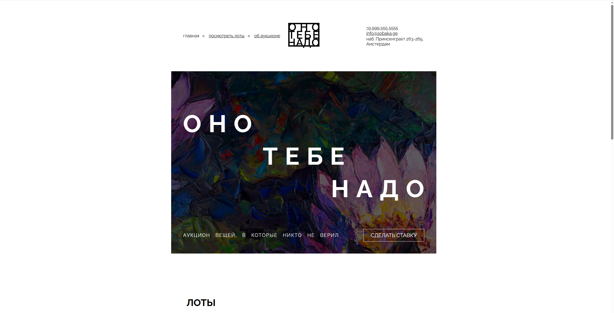
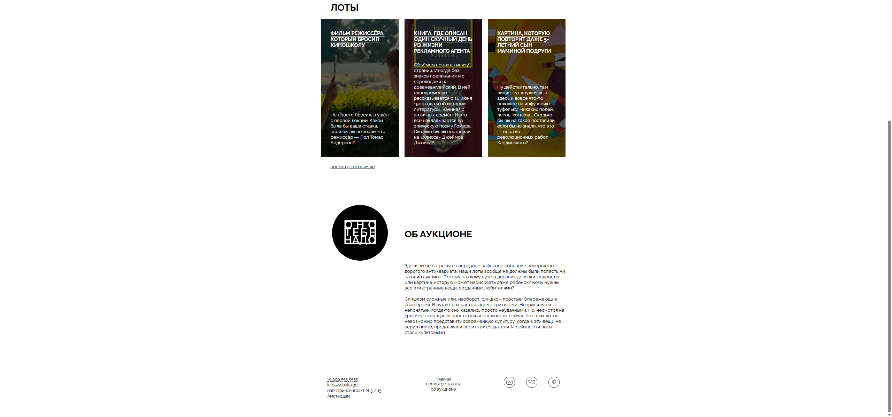

# Оно тебе надо — аукцион вещей, в которые никто не верил

Учебный проект: адаптивная вёрстка главной страницы аукциона по макету из Figma (ширина макета — 1100px).

## Что сделано

- Семантическая структура страницы: `header`, `main` (секции `cover`, `lots`, `about`), `footer`.
- Шапка на гридах: меню, логотип по центру, блок с адресом.
- Обложка с фоновым изображением, затемняющим оверлеем, заголовком из трёх строк и кнопкой «Сделать ставку».
- Секция «Лоты»: список из трёх карточек на флексбоксе, у каждой свой фон и оверлей.
- Секция «Об аукционе»: двухколоночная сетка, логотип в чёрном круге и два абзаца текста.
- Подвал на гридах: адрес, меню и ссылки на соцсети.
- Подключён шрифт Raleway, стили вынесены в отдельные файлы.
- Вёрстка проверена на соответствие макету с помощью Pixel Perfect и автотестов.

## Скриншоты





## Технологии

HTML5, CSS3 (Grid, Flexbox), БЭМ-подобные имена классов.

## Структура проекта

```
├── fonts/
├── images/
├── styles/
│   ├── global.css
│   └── style.css
└── index.html
```
